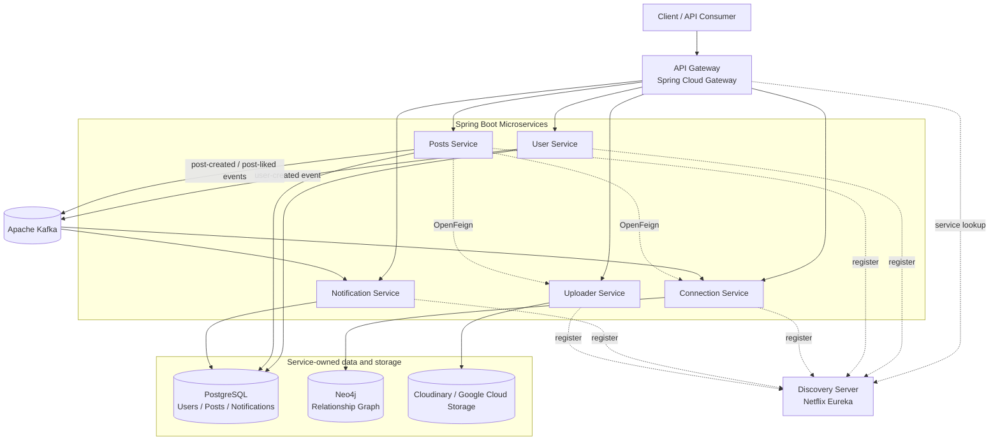
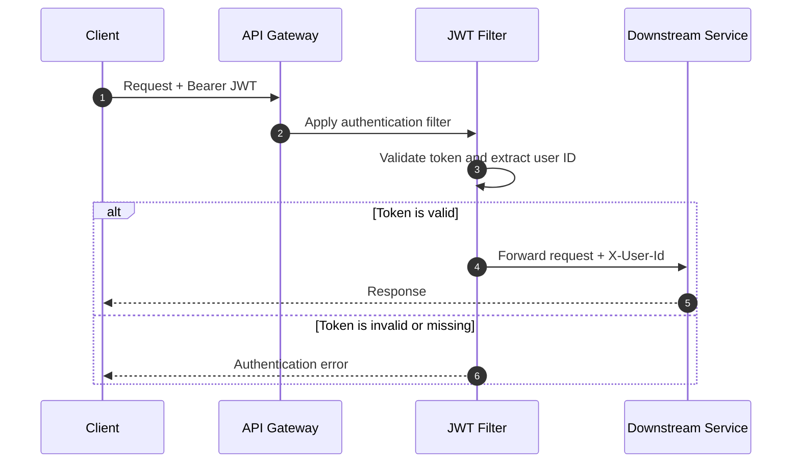
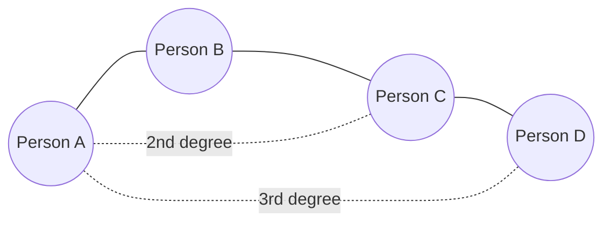
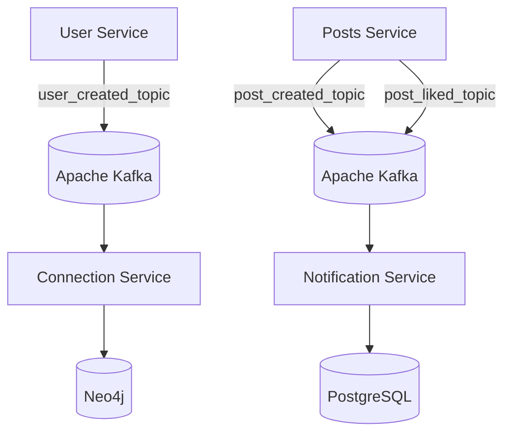

<div align="center">

# 🌲 ForestLink
### A Distributed Professional Networking Platform

**Connect people. Model relationships. Process events. Scale services independently.**

<p>
  
  
  
  
  
  
</p>

<p>
  <a href="https://github.com/vaibhav-m-bansode/Project-PL01-LinkedIn">
    
  </a>
  
  
</p>

*A backend-first engineering project exploring service boundaries, synchronous and asynchronous communication, graph-based relationships, and distributed application design.*

</div>

---

## 🌿 The idea

ForestLink is a professional networking backend inspired by the core capabilities of platforms such as LinkedIn.

Instead of building one large application, the system is divided into independently structured Spring Boot services. Each service owns a specific business capability and communicates with other services through APIs or Kafka events.

The platform brings together:

- **Identity and access** — user registration, login, and JWT-based authentication.
- **Professional relationships** — connection requests and multi-degree network traversal.
- **Content and engagement** — posts, likes, and media references.
- **Event-driven workflows** — asynchronous processing for user and post events.
- **Notifications** — consuming events and persisting notification records.
- **Media storage** — a dedicated uploader service integrated with external storage providers.

> **Project scope:** This repository currently focuses on the backend. A frontend and production deployment are not included in the current implementation.

---

## 🏛️ Architecture at a glance

The system uses an API Gateway as the external entry point, Eureka for service discovery, OpenFeign for selected synchronous service-to-service calls, and Kafka for asynchronous event delivery.



### Service responsibilities

| Service | Responsibility | Main technologies |
|---|---|---|
| **API Gateway** | Routes incoming requests and applies JWT authentication filters to protected routes | Spring Cloud Gateway, JWT |
| **Discovery Server** | Service registration and discovery | Netflix Eureka |
| **User Service** | Registration, login, and user-related operations | Spring Boot, JPA, PostgreSQL, JWT |
| **Posts Service** | Post operations, likes, and event publishing | Spring Boot, JPA, PostgreSQL, Kafka |
| **Connection Service** | Connection workflows and relationship traversal | Spring Boot, Neo4j, Kafka |
| **Notification Service** | Consumes post events and stores notifications | Spring Boot, Kafka, PostgreSQL |
| **Uploader Service** | Handles media upload operations | Spring Boot, Cloudinary, Google Cloud Storage |

---

## 🔐 Authentication and request flow

Protected requests enter through the API Gateway. The gateway's JWT filter validates the token and forwards the authenticated user identity to downstream services using the `X-User-Id` header.



The gateway configuration currently exposes user routes separately from routes protected by the custom JWT filter.

**Security note:** Never use a committed JWT secret in a real deployment. Move secrets to environment variables or a secret manager, rotate any secret that has been exposed, and avoid trusting identity headers from untrusted external clients.

---

## 🌐 API Gateway routes

The current gateway configuration defines these route prefixes:

| External route | Destination | Gateway JWT filter |
|---|---|---|
| `/api/v1/users/**` | User Service | Not applied at this route |
| `/api/v1/posts/**` | Posts Service | Applied |
| `/api/v1/connections/**` | Connection Service | Applied |
| `/api/v1/uploader/**` | Uploader Service | Applied |
| `/api/v1/notification/**` | Notification Service | Applied |

The gateway uses `StripPrefix=2` before forwarding requests. Check the controller mappings in each service when constructing the final downstream endpoint.

---

## 🕸️ Relationship graph with Neo4j

Professional connections are naturally graph-shaped. The Connection Service uses Neo4j to represent people and their relationships rather than relying on deeply nested relational joins.

The relationship domain includes:

- Connection requests.
- Accepting and rejecting requests.
- First-degree connections.
- Second-degree connections.
- Third-degree connections.

Conceptually:



This model makes relationship traversal a first-class operation and gives the connection domain a database suited to connected data.

---

## ⚡ Event-driven communication with Kafka

Not every operation needs an immediate response from another service. Kafka is used for workflows that can be processed asynchronously.

### Event flows



| Producer | Event/topic | Consumer | Purpose |
|---|---|---|---|
| User Service | `user_created_topic` | Connection Service | Initialize a person's graph record |
| Posts Service | `post_created_topic` | Notification Service | Process post-created notifications |
| Posts Service | `post_liked_topic` | Notification Service | Process post-like notifications |

**Implementation detail to verify:** The current User Service topic declaration uses `user_Created_Topic`, while its producer and the Connection Service consumer use `user_created_topic`. Kafka topic names are case-sensitive. Align the declaration with the producer and consumer before relying on automatic topic creation or deploying this flow.

### Why use both Feign and Kafka?

| Communication | Best suited for | Used in this project |
|---|---|---|
| **OpenFeign (synchronous)** | A caller needs a response before continuing | Posts Service calls other services for request-time operations |
| **Kafka (asynchronous)** | A downstream task can happen independently | User-created, post-created, and post-liked event flows |

This separation keeps request/response operations distinct from background event processing.

---

## 🗄️ Data ownership

The project follows a database-per-service direction: each domain uses storage suited to its data.

| Data store | Domain | Stored data |
|---|---|---|
| PostgreSQL | User Service | User/account records |
| PostgreSQL | Posts Service | Posts and engagement data |
| PostgreSQL | Notification Service | Notification records |
| Neo4j | Connection Service | People and relationship graph |
| Cloudinary / Google Cloud Storage | Uploader Service | Uploaded media assets |

The services should own their persistence logic. Avoid having one service directly modify another service's database.

---

## 🧰 Technology stack

<div align="center">

| Layer | Technologies |
|---|---|
| Language | Java 21 |
| Application framework | Spring Boot 4.1.1 |
| Gateway and discovery | Spring Cloud Gateway, Netflix Eureka |
| Service communication | Spring Cloud OpenFeign |
| Messaging | Apache Kafka, Spring for Apache Kafka |
| Persistence | Spring Data JPA, Hibernate |
| Relational database | PostgreSQL |
| Graph database | Neo4j, Spring Data Neo4j |
| Security | JWT, BCrypt |
| Object/media storage | Cloudinary, Google Cloud Storage |
| Build and container images | Maven, Jib |
| Supporting libraries | Lombok, MapStruct |
| Development infrastructure | Docker, Kafbat UI |

</div>

---

## 📁 Repository layout

```text
Project-PL01-LinkedIn/
│
├── apiGateway/          # External API entry point and JWT filter
├── discoveryServer/     # Eureka service registry
├── userService/         # User identity and authentication
├── postsService/        # Posts, likes, and Kafka producers
├── connectionService/   # Connection graph and Kafka consumer
├── notificationService/ # Notification event consumers
├── uploaderService/     # Media upload integration
└── kafbatui/            # Kafka UI configuration
```

Each service is maintained as its own Spring Boot Maven application.

---

## 🚀 Run locally

The repository contains multiple independently runnable services. Start the infrastructure first, then launch the services.

### Prerequisites

- Java 21
- Maven (or the Maven Wrapper, if present in the service directory)
- PostgreSQL
- Neo4j
- Apache Kafka
- Git

Docker and Kafbat UI are useful for local infrastructure management.

### 1. Clone the repository

```bash
git clone https://github.com/vaibhav-m-bansode/Project-PL01-LinkedIn.git
cd Project-PL01-LinkedIn
```

### 2. Start infrastructure

Start PostgreSQL, Neo4j, and Kafka using your local installation or Docker setup.

Create the databases required by the services and make sure the connection details match each service's configuration.

### 3. Configure environment-specific values

Before starting the applications, configure the required values for:

- PostgreSQL URLs, usernames, and passwords.
- Neo4j URI and credentials.
- Kafka bootstrap server.
- JWT signing secret.
- Cloudinary credentials, if using Cloudinary.
- Google Cloud Storage credentials, if using GCS.

Use local environment variables or an untracked configuration file. Do not commit credentials.

### 4. Start the Discovery Server

Open a terminal:

```bash
cd discoveryServer
./mvnw spring-boot:run
```

The Eureka dashboard is configured at:

`http://localhost:8761`

On Windows, use `mvnw.cmd spring-boot:run` if the wrapper is available.

### 5. Start the application services

In separate terminals, run each service from its own directory:

```bash
cd userService
./mvnw spring-boot:run
```

Repeat for:

```text
postsService
connectionService
notificationService
uploaderService
apiGateway
```

Recommended startup order:

1. Infrastructure: PostgreSQL, Neo4j, Kafka.
2. Discovery Server.
3. User, Connection, Posts, Notification, and Uploader services.
4. API Gateway.

The gateway is the intended entry point for client requests.

> **Note:** Exact service ports and all required environment variable names should be taken from each service's current configuration. They are intentionally not guessed here.

---

## 📦 Containerization and deployment direction

The Maven configuration uses the **Jib Maven Plugin** to build container images for services.

A typical Maven package command is:

```bash
./mvnw clean package -DskipTests
```

The configured Jib execution is bound to the Maven package phase. Image publishing also requires valid registry credentials and the appropriate build configuration.

Kubernetes-oriented application configuration is present in the repository. A complete, verified production deployment is a separate step; do not treat configuration files alone as proof of a production-ready cluster deployment.

---

## 🧭 Engineering decisions

| Decision | Reason |
|---|---|
| API Gateway | Centralized external routing and authentication filtering |
| Eureka | Service registration and discovery |
| OpenFeign | Declarative synchronous service calls |
| Kafka | Decoupled asynchronous workflows |
| PostgreSQL | Relational and transactional domain data |
| Neo4j | Relationship traversal and graph queries |
| Dedicated uploader service | Isolates media-provider integration |
| Service-owned persistence | Reduces direct database coupling between domains |

---

## 🛠️ Development roadmap

- [x] Separate Spring Boot services by business capability
- [x] API Gateway routing
- [x] Eureka service discovery
- [x] JWT authentication filter at the gateway
- [x] User registration and login flow
- [x] Posts and like/unlike workflows
- [x] Neo4j-based connection domain
- [x] Kafka event producers and consumers
- [x] Notification persistence
- [x] OpenFeign-based service communication
- [x] Media uploader integration
- [ ] Align and verify Kafka topic declarations across producers and consumers
- [ ] Externalize all secrets and validate configuration profiles
- [ ] Add comprehensive unit and integration test coverage
- [ ] Add OpenAPI documentation for service APIs
- [ ] Add centralized logs, metrics, and distributed tracing
- [ ] Add reproducible local infrastructure orchestration
- [ ] Complete Kubernetes deployment manifests and deployment verification
- [ ] Build a frontend client

---

## 🔭 What this project demonstrates

ForestLink is a practical exploration of backend engineering beyond building CRUD endpoints:

- Decomposing a domain into independently deployable services.
- Designing synchronous and asynchronous communication paths.
- Propagating authenticated identity across service boundaries.
- Modeling relationship traversal with a graph database.
- Publishing and consuming domain events.
- Separating data ownership by service.
- Integrating external media storage.
- Preparing services for container-based deployment.

---

## 👨‍💻 Author

**Vaibhav Bansode**  
Information Technology undergraduate | Java Backend Development

- GitHub: [@vaibhav-m-bansode](https://github.com/vaibhav-m-bansode)
- Project: [Project-PL01-LinkedIn](https://github.com/vaibhav-m-bansode/Project-PL01-LinkedIn)

---

<div align="center">

### 🌱 Built to learn. Designed to scale. Growing one service at a time.

<sub>If you find the project interesting, consider giving the repository a ⭐</sub>

</div>
